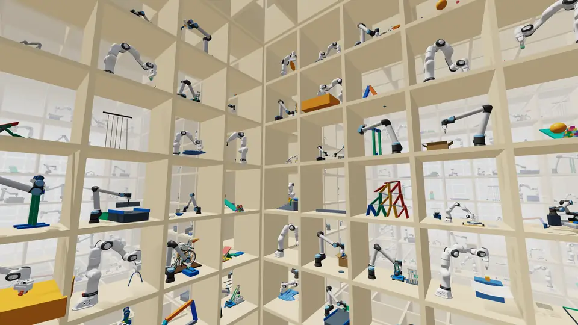

# Steel

[](assets/launch.mp4)

Steel is Skild's GPU-accelerated rigid-body physics solver for scalable simulation of manipulation. Skild AI developed Steel in collaboration with NVIDIA. Steel is implemented inside [Newton](https://github.com/newton-physics/newton), the open-source physics engine hosted by the Linux Foundation.

Across 20 robot-learning benchmarks, Steel delivers **3.8× PhysX's simulation throughput** (geometric mean), and **up to 13×** on heterogeneous batches that mix different robots and tasks, while using less GPU memory. See the [launch write-up](https://www.skild.ai/blogs/steel) for the benchmarks and evaluation conditions.

We are actively accepting contributions from you and your agents, and are committed to maintaining Steel as a shared foundation for diverse, scalable simulation.

[Solver code](https://github.com/newton-physics/newton/tree/main/newton/_src/solvers/steel) · [Examples](examples/) · [Playground](https://www.skild.ai/steel/playground) · [Blog](https://www.skild.ai/blogs/steel)

## Updates

- **November 9, 2026** — The open-source launch of Steel.

## Examples

[Explore the examples](examples/README.md): a collection of runnable scenes for building robot-learning environments, migrated from Steel Shelf. It includes robot arms, grippers, stacks, cloth, cables and closed-loop mechanisms, with solver presets, an interactive browser, live tuning and benchmarking tools.

Start with an example yourself, or point your coding agent at the collection and have it build the environment you need.

[](examples/README.md)

```bash
git clone https://github.com/skild-ai/steel.git
cd steel/examples
uv sync
uv run python -m shelf play
```

To list examples or open one directly:

```bash
uv run python -m shelf list
uv run python -m shelf play basic_pendulum
```

The examples are a separate Python project under `examples/`. They are pinned to [skild-ai/newton](https://github.com/skild-ai/newton), a Newton development fork, until the changes they need are in a Newton release; the solver itself is not copied into this repository. See the [examples README](examples/README.md) for setup, tuning, testing, supported presets and asset requirements.

## Code and demos

- [Steel in Newton](https://github.com/newton-physics/newton/tree/main/newton/_src/solvers/steel) — the solver implementation integrated into Newton.
- [Docs and tutorials](site/README.md) — the documentation site: concepts, guides, the configuration reference and [runnable tutorials](tutorials/README.md), each with a recorded 3D replay. Preview it with `cd site && npm ci && npm run dev`.
- [Examples](examples/README.md) — runnable scenes and solver presets. The [package configuration](examples/pyproject.toml) records their exact Newton dependency.
- [WebGPU implementation](https://github.com/skild-ai/steel-webgpu) — the browser implementation.
- [Playground](https://www.skild.ai/steel/playground) — interactive demos.
- [Blog](https://www.skild.ai/blogs/steel) — the launch write-up.

## Projects using Steel

So far these are our own:

- **[Steel examples](examples/README.md)** — Newton scenes with Steel presets, including rigid-body examples and scenes coupling Steel with deformable solvers.
- **[Steel Playground](https://www.skild.ai/steel/playground)** — interactive browser demos using the [WebGPU implementation](https://github.com/skild-ai/steel-webgpu).

Using Steel in a project? Open a pull request to add it here, with a link and a short description.

## Contributing

Contributions to the examples and this documentation belong in this repository. Read [CONTRIBUTING.md](CONTRIBUTING.md) before changing a scene or a preset; include the checks you ran.

Steel solver development happens inside Newton. Changes to the implementation need a pull request against the Newton code repository containing the version you are changing, rather than this README-and-examples repository. The examples' current development-fork revision is pinned in [pyproject.toml](examples/pyproject.toml).

## License

Copyright 2026 Skild AI and the Steel contributors. Steel was created by Skild AI in collaboration with NVIDIA; the authors are listed in [AUTHORS](AUTHORS). Steel is licensed under the [Apache License, Version 2.0](LICENSE). The solver is distributed as part of [Newton](https://github.com/newton-physics/newton), the open-source physics engine hosted by the Linux Foundation, which is also licensed under Apache-2.0.

The examples package includes Apache-2.0 code and BSD-3-Clause robot model data. Its component licenses, notices and distribution metadata are retained under [examples/THIRD_PARTY.md](examples/THIRD_PARTY.md), [examples/NOTICE](examples/NOTICE), and [examples/licenses/](examples/licenses/). Optional downloaded assets and media retain their own terms; the root Apache license does not replace them.

The launch video and its poster in [assets/](assets/) are Copyright 2026 Skild AI and licensed under Apache-2.0.

Skild, Skild AI and the Skild logo are trademarks of Skild AI and are not licensed under Apache-2.0.
