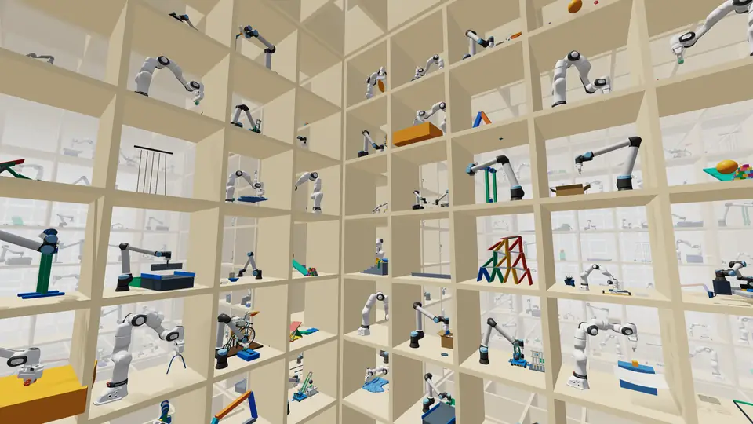
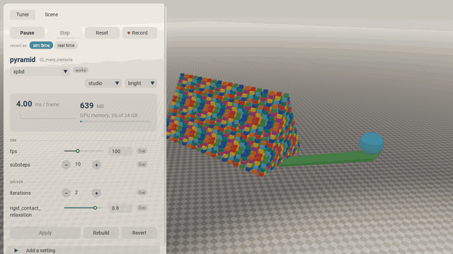

# Steel examples

Curated [Newton](https://github.com/newton-physics/newton) examples, one folder per physics feature, each
with a solver preset for every solver that can run it.



*Each cubby holds one of 26 shelf examples, run with its Steel preset (coupled with VBD for the cloth,
cable and soft-body scenes), recorded, and set in as a miniature. The camera passes from room to room
through the shelves to `jenga`, `franka_shirt_fold_stack` and `crane_wrecking_ball`.*

The shelf holds 147 examples. 102 are Newton's own examples from the pinned Newton revision (see *Setup*), sorted
by the feature they exercise rather than by solver. 33 are scenes from
[steel-webgpu](https://github.com/skild-ai/steel-webgpu) that Newton has no example for (see *Ported scenes*).
The other 12 are the shelf's own: four closed-loop mechanisms, `pyramid_drop`, and seven scenes adapted from
MuJoCo's `model/` directory (`mjorg_*`). Most of the Newton examples left out simulate only cloth, soft bodies,
MPM or particles, with no rigid or articulated part for Steel.
Every Newton example runs exactly as it does in Newton, but its solver settings live in a `presets.toml` next to it
instead of in the code.

This collection was migrated from the Steel Shelf project.
It remains a separate Python project inside `examples/`. Run the commands below from this directory.

## Setup

```bash
git clone https://github.com/skild-ai/steel.git
cd steel/examples
uv sync
uv run python -m shelf list
```

Newton is pinned in `pyproject.toml` to a revision of [skild-ai/newton](https://github.com/skild-ai/newton), a
Newton development fork, until the changes these examples need are in a Newton release. A GPU with CUDA is recommended; most examples also run on CPU.

## Three ways to run an example

Every example runs in three modes. All of them take `--solver <preset>` and `--set section.key=value`,
and pass any other argument to the example itself.

**Play** (interactive): the OpenGL viewer with the shelf's side bar: play / pause, step, reset,
**Record**, the look drop-down, the bar's theme (steel by default, dark, or bright) and Newton's scene
controls. The frame rate and model counts sit in a matching card on the right. Record captures the viewport
as **sim time** (one video frame per simulation frame, played at the example's frame rate, so the
video runs at simulation speed) or **real time** (a 60 fps video as long as the recording took);
**Stop** opens a dialog to save the mp4 under a name and folder (or through the system's Save as…
dialog) or to discard it. The bar is translucent until the cursor is on it. The « button at its top
right (or the **B** key) minimizes it to a small pill with play / pause and record; » or **B** brings
it back. Mouse picking works as in Newton. **switch example…** under the example's name opens any
other example in the same window, at its default preset, without restarting (also in tune mode).
**browse** next to it opens the example browser: every example as a card under its section, with a
preview, a one-line description and a chip per preset that runs it. A card opens the example at its
default preset, a chip at that preset, Escape returns. `python -m shelf play` or `python -m shelf tune` with
no example starts in the browser.

```bash
uv run python -m shelf play                                     # the example browser
uv run python -m shelf play basic_pendulum                      # default preset
uv run python -m shelf play basic_pendulum --solver kamino      # another solver's preset
uv run python -m shelf play basic_pendulum --set sim.substeps=20 --set solver.iterations=4
uv run python -m shelf play basic_pendulum --viewer usd --output-path pendulum.usd   # any Newton viewer flag
```

`run` is an alias of `play`. Everything Newton's examples accept (`--viewer gl|usd|rerun|viser|null`,
`--num-frames`, `--device`, `--paused`, ...) works after the example name.

**Throughput**: headless, at a world count you choose. Reports frame and substep time (mean, median,
p95), throughput in frames, world-frames and world-substeps per second, and GPU memory (the process
total and Warp's peak allocations).

```bash
uv run python -m shelf bench robot_cartpole --world-count 4096
uv run python -m shelf bench robot_g1 --solver kamino --world-count 1024 --frames 500 --json results.jsonl
```

Only examples with a `--world-count` argument scale up (27 today); the rest report one world. Every example
runs in all three modes except `recording`, which runs its own loop to write the file `replay_viewer` plays.



*`python -m shelf tune pyramid`: the side bar's Tuner tab, a live change to the XPBD iterations, and the
wrecking ball arriving.*

**Tune** (interactive tuner): the viewer with one side bar and two tabs. **Scene** holds Newton's own
viewer controls (model info, what to draw, example and rendering options, camera). **Tuner** has
play / pause, step, reset and **Record** (as in play mode: Stop asks where to save the mp4, or
discards it), the preset and look drop-downs, live step time and GPU memory, and every setting of the
preset as a control: sliders with a typed field (logarithmic for stiffness, tolerances and
capacities, with a tick at the saved value), steppers for small integers, segmented buttons for
options, switches for booleans. Below the preset's own solver settings, a closed group
"*N* more at their defaults" lists every other setting the solver takes: its constructor arguments,
or for Kamino and implicit MPM every field of the `Config` and its nested configs. It has a filter
box, and each row starts at the solver's default. *auto* marks a setting the solver works out itself
(MuJoCo's `iterations` from the MJCF, `njmax` from the scene), with the value the running solver
uses when it can be read; **set** gives it a value to edit. A changed default joins the preset's
settings after Apply and is saved with them; one set back to its default leaves the list again.
Settings for debugging or that change what the example must build (`deterministic`,
`save_to_mjcf`, `use_mujoco_cpu`, `separate_worlds`, ...) and arguments the example passes to the
solver itself are left out (see [`common/defaults.py`](common/defaults.py)). Ranges and option
lists come from [`common/ranges.toml`](common/ranges.toml) and Newton's type hints. Edit values and press **Apply**;
the scene keeps running and keeps its state. Each setting is labelled with how Apply makes it take
effect, from cheapest up:

| tier | what Apply does | settings |
| --- | --- | --- |
| live | sets the attribute the solver or example reads every step | `sim.fps`, `sim.substeps`, and per solver: XPBD `iterations` and the three `*_relaxation`; VBD `iterations`, `friction_epsilon`; SemiImplicit `angular_damping`, `friction_smoothing`, `enable_tri_contact`, `joint_mimic_ke/kd`; Featherstone `update_mass_matrix_interval`; Style3D `iterations`, `linear_iterations`; Steel `iterations`, `enable_restitution`; MuJoCo `iterations`, `ls_iterations`, `tolerance`, `ls_tolerance`, `update_data_interval`; implicit MPM `max_iterations`, `tolerance`; coupled `rho`, `gamma`, `iterations`, `contact_matching_force_scale` |
| model | writes the Model array (entries still holding the old value) and calls `notify_model_changed` | `model.default_shape_cfg.*`, `model.default_joint_cfg.target_*`, `model.joint_target_ke/kd`, `model.soft_contact_*`, `model.cloth.tri_*` and `cloth.spring_*` |
| swap | builds a new solver on the running model and states (only the warm start is lost) | every other `solver.*` and `entries.*.solver.*` key: capacities, modes, Kamino and coupled configs |
| rebuild | constructs the example again | every other `model.*` key, `collision.*` except Kamino's `interval`, and the Steel tabletop demos, which build their solver inside Newton |

The CUDA graph is captured again after every Apply, so step times stay those of play mode. **Rebuild**
forces a full rebuild with the applied settings and **Revert** drops them. When a cheaper tier cannot
do the job (a solver that cannot be built twice on the same model, such as Kamino with named
materials; an example that sized a buffer by the substep count at build time; a value the solver
rejects), the tuner falls back to a rebuild by itself and says why in the panel. The tiers are in
[`common/live.py`](common/live.py); the swap tier needs examples whose solver setup is more than one
line to expose it as `build_solver()` (see [AGENTS.md](AGENTS.md)). `scripts/live_check.py <example>`
exercises every tier headless, and `scripts/live_sweep.py` runs it for every working preset.

**Save as** asks for a file name and writes the tuned preset to a new TOML file in the example's
folder; it never touches `presets.toml`. The new file has the same layout, so `--presets <file>` loads
it in every mode, and `shelf check --presets <file>` checks it. A value applied live is not proof that
the same value behaves identically from a fresh build, so check the saved file.

```bash
uv run python -m shelf tune basic_pendulum --solver kamino            # Save as -> kamino_tuned.toml
uv run python -m shelf play basic_pendulum --presets kamino_tuned.toml
uv run python -m shelf check basic_pendulum --presets kamino_tuned.toml --every
```

To make a tuned preset the shelf's preset, copy its table into `presets.toml` and run `shelf check`.

**Looks.** `play` and `tune` draw the scene with a *look*: the palette for shapes that use Newton's
default colors, the floor, the sky, the ambient fill, the sun, exposure, roughness, shadow softness and
the fog range (Newton greys shapes out from 20 m; the shelf's looks start at 80 m so scenes keep their
colour at normal camera distances). A look changes how the scene is drawn, never what is simulated, and
shapes an example colors on purpose keep their color. Looks live in [`common/looks.toml`](common/looks.toml); `steel`, steel-webgpu's studio look (with
the matching `steel` bar theme), is the default, `studio`, `pastel` and `paper` are alternatives, and
`newton` is Newton's own look. The tuner has a **look**
drop-down to switch live.

```bash
uv run python -m shelf play pyramid                 # steel look
uv run python -m shelf play pyramid --look newton   # as Newton draws it
```

**Previews.** The browser's previews are one frame of each example, rendered headless in the look and
cached under `~/.cache/steel-shelf/thumbs/<look>/`. `python -m shelf play` with no example renders the
missing ones in the background and says so (the whole shelf takes a few minutes the first time; the
browser fills in as they finish); `python -m shelf play <example>` never renders them. `python -m shelf
thumbs` renders them on demand (`--missing`, `--force`, `--jobs N`). What a card says comes from the
example's `presets.toml`: a `[gallery]` table with `short`, the one line, and optionally `frame`, the
frame the preview shows (default 60), and `title`. A file without one gets a warning.

**Ported scenes.** The 35 steel-webgpu scenes that are not Newton examples live on the shelf too, 33 as examples
of their own and two as options of existing ones, each in the section its feature belongs to, with a `[steel]` preset carrying the browser's settings. The 22 built in
steel-webgpu's `tools/scenes.py` are examples on `common/steel_scenes.py`: the builder function moved in as it
is, the shelf's loop around it; where the browser has a compare toggle, a `[steel_off]` preset is the toggle
off. Two of them extend existing examples instead: `domino_spiral --num-dominoes 480 --scale 0.28` and
`sleeping --scene boxes`. The 13 hero-montage scenes (robot tabletop demos such as `toaster` and `cereal`)
come from Newton's `hero_montage` scripts, which the shelf does not have, so each is rebuilt from its
exported `scene.json` and `scene.bin` (kept next to the example) by `common/exported_scene.py`: bodies,
convex hulls, joints, filters and the 60 Hz joint-target path are exact; the visual meshes draw when a
steel-webgpu checkout sits next to the shelf (or `STEEL_WEBGPU_ASSETS` names its `assets/scenes/shared`),
and the collision hulls draw otherwise.

## Layout

```
common/       preset loader and the `python -m shelf` command
shelf/
    00_basics/                    building, stepping and viewing a scene; selection
    01_basic_contacts/            a few objects touching in simple ways
    02_many_contacts/             piles, stacks, walls, rain
    03_mesh_sdf_contacts/         detailed shapes: meshes, SDFs, hydroelastic contact
    04_mimic_joints/              one joint copying another
    05_looped_linkages/           closed kinematic loops, no contact
    06_looped_linkages_contacts/  closed loops that touch things
    07_articulations/             robots: arms, legs, hands, controllers
    08_volumetric_soft_bodies/    squishy 3D objects and soft-rigid contact
    09_thin_shells_and_rods/      cloth and cables
    10_tendons/                   strings pulling on joints
    11_particles/                 a robot on MPM sand
    12_coupling/                  two solvers in one scene
    13_sensors/                   contact, IMU and camera sensors
    14_ik/                        inverse kinematics
    15_diffsim/                   differentiable simulation
```

Each example folder holds `example.py` and `presets.toml`.

## Presets

The presets in this repo are **play-mode presets**: settings that run the example's scene well at its
default size. Throughput presets are a separate, later step (see [TODO](#todo)).

A preset is one solver's settings for one example: timing (`sim`), collision settings (`collision`),
solver arguments (`solver`) and per-solver model tweaks (`model`), plus a `status`:

| Status | Meaning |
| --- | --- |
| works | `python -m shelf check` ran the example's tests with this preset and they passed |
| unstable | the last check failed; see its `note` |
| unsupported | the solver cannot simulate this scene; see its `reason` |
| untested | no preset yet |

The `feather_pgs` tables are inert at this pin: they map to `SolverFeatherPGS`, Steel's earlier name, which the
pinned Newton does not have, and every one of them is `untested` or `unsupported`.

[PRESETS.md](PRESETS.md) shows every example against every solver. To check presets:

```bash
uv run python -m shelf check basic_pendulum --every   # all presets of one example
uv run python -m shelf check --all                    # every working preset; rewrites PRESETS.md
```

[AGENTS.md](AGENTS.md) has the rules for editing examples and presets.

### Checking on a GPU

CI runs on GitHub-hosted runners without a GPU, so it checks the lockfile, lint, license audit and
`shelf list`, but no physics. Before merging a change to a preset, an example, `common/` or the Newton
pin, run `shelf check` on a CUDA GPU from `examples/` and paste the result table into the pull request.
`--dry-run` leaves `presets.toml` and `PRESETS.md` untouched:

```bash
uv sync
uv run python -m shelf check <changed examples> --every --dry-run
# Steel smoke set: robot arms, exported scenes, SDF contact, loops, a coupled preset
uv run python -m shelf check basic_pendulum pyramid toaster cereal viaduct_kit nut_bolt_sdf \
    mjorg_house_of_cards ratio_stack basic_conveyor_forces loop_stewart_platform robot_g1 \
    cup_unpacking --solver steel --dry-run
uv run python -m shelf check boxes_chain_on_cloth --solver steel_xpbd --dry-run
```

Every line should read `works`. A Newton pin change also needs the whole shelf:
`uv run python -m shelf check --all` records the results in `presets.toml` and rewrites `PRESETS.md`.

## TODO

- [ ] **Play presets for every solver.** Fill and check a preset for each solver that can simulate each
  example; today most examples have presets only for the solvers Newton's own version supports
  (see the untested cells in [PRESETS.md](PRESETS.md)).
- [ ] **Throughput presets.** Tune and save a second preset per solver for throughput mode: settings that
  stay correct at large world counts while maximizing world-substeps per second (substeps, iterations,
  contact and row capacities, CUDA graph use). Decide how they are stored next to the play presets and
  have `shelf bench` load them, and record the measured throughput, GPU and world count with each.
- [ ] **`--world-count` everywhere.** Add a world-count argument to the examples that simulate a single
  scene, so every example can be benchmarked at scale.
- [ ] **`feather_pgs` tables.** Drop the inert `feather_pgs` column, or map it to a solver the pin has.
- [ ] **Featherstone `angular_damping`.** The pinned Newton stores it on `SolverFeatherstone` but never
  reads it, so the `featherstone.solver.angular_damping` presets change nothing. Drop them or fix upstream.

## License

The examples package contains Apache-2.0 code and BSD-3-Clause model data.
Its wheel and sdist declare `Apache-2.0 AND BSD-3-Clause`. See [THIRD_PARTY.md](THIRD_PARTY.md),
[NOTICE](NOTICE), and [the complete component notices](licenses/). Optional downloaded
models and policies retain their own terms, including restrictions where documented.
